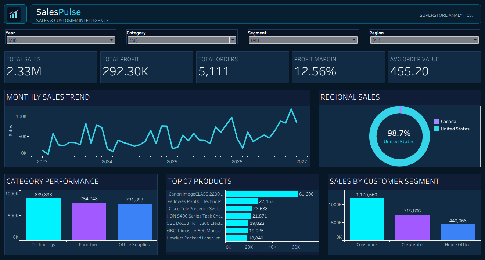

# SalesPulse — Sales & Customer Intelligence Dashboard

An interactive Tableau dashboard designed to explore sales performance, profitability, product trends, regional sales, and customer segments.

## Dashboard Preview



## Project Overview

SalesPulse transforms Superstore sales data into an interactive business intelligence dashboard. It helps users explore key performance indicators and identify patterns across time, product categories, regions, and customer segments.

## Key Performance Indicators

- Total Sales
- Total Profit
- Total Orders
- Profit Margin
- Average Order Value

## Dashboard Visualizations

- Monthly Sales Trend
- Regional Sales Analysis
- Category Performance
- Top Products
- Sales by Customer Segment

## Interactive Filters

- Order Year
- Category
- Segment
- Region

Users can filter the dashboard to explore performance across different business dimensions.

## Tools & Technologies

- Tableau Public
- Microsoft Excel
- Data Visualization
- Business Intelligence
- Dashboard Design

## Dataset

The dashboard uses the EU Superstore Sales sample dataset.

The workbook is packaged as a Tableau `.twbx` file. Please refer to the dataset source and attribution information in the `data/README.md` file.

## Project Structure

```text
dashboard/       Tableau packaged workbook
data/            Dataset source and attribution notes
screenshots/     Dashboard preview
documentation/   Data dictionary and QA checklist
assets/          Branding assets
```

## Interactive Dashboard

[View SalesPulse on Tableau Public](PASTE_TABLEAU_PUBLIC_URL_HERE)

## Author

Muhammad Hassan  
Data Analyst | SQL | Excel | Power BI | Tableau

GitHub: [hassandataanalyst](https://github.com/hassandataanalyst)
